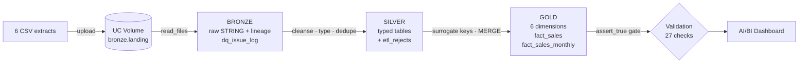
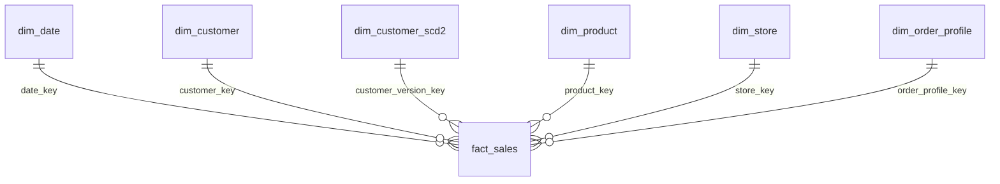

# UrbanMart Sales Data Mart on Databricks

**Medallion lakehouse + Kimball star schema, built with Databricks SQL, Delta Lake and Unity Catalog.**
Capstone project of the **EY Data Engineering Bootcamp** (2026).

UrbanMart is a Greek retail chain with 12 physical stores and one online store. Its operational system exports CSV extracts.
This project turns them into a validated sales data mart that answers five questions of the Commercial Director:

1. Monthly revenue, gross margin and units sold, by region and store
2. Which categories and brands drive the most margin
3. Top customers per segment
4. Return rate by category and store type
5. Weekdays vs weekends, online vs physical stores

---

## Architecture



| Layer | Schema | Content |
|---|---|---|
| Landing | `urbanmart.bronze.landing` (Volume) | The 6 uploaded CSV files |
| Bronze | `urbanmart.bronze` | One table per file, every column `STRING`, `_source_file`, `_ingested_at`; `dq_issue_log` |
| Silver | `urbanmart.silver` | Standardised, typed, de-duplicated tables; `stg_*` tables with per-row `dq_errors`; `etl_rejects` |
| Gold | `urbanmart.gold` | `dim_date`, `dim_customer`, `dim_customer_scd2`, `dim_product`, `dim_store`, `dim_order_profile`, `fact_sales`, `fact_sales_monthly`, `etl_validation_log` |

Catalog and schema names are notebook / job parameters. In the shared bootcamp workspace the project runs in
`bootcamp.um_bronze_antonismp`, `bootcamp.um_silver_antonismp` and `bootcamp.um_gold_antonismp`.

The whole chain runs as one **Lakeflow Job** — the validation notebook is the final task, so a failed check fails the run.

## Star schema

**Grain of `fact_sales`: one row per order line of a valid order.**



- Surrogate keys `BIGINT GENERATED BY DEFAULT AS IDENTITY`; **unknown member `-1`** in every dimension (guest orders, unknown product).
- `PRIMARY KEY` / `FOREIGN KEY` constraints (informational in UC, tested by the validation gate); **enforced `CHECK` constraints** on the fact.
- `fact_sales` uses **liquid clustering** `CLUSTER BY (date_key)`.
- **SCD Type 2** customer history with a **point-in-time join** from the fact; **junk dimension** for payment method × order status;
  aggregate fact `fact_sales_monthly` (month × store × category).

Full model, measure classification (additive / non-additive) and trade-offs: [`docs/design_note.md`](docs/design_note.md).

## Data quality

The extract contains deliberate defects. All were found in profiling, logged with a handling rule and either repaired or routed to
`silver.etl_rejects` with a reason code — see [`docs/dq_log.md`](docs/dq_log.md).

| Defect | Rows | Handling |
|---|---:|---|
| Duplicate customer records | 8 | De-duplicated, extras rejected |
| City in UPPER CASE + trailing space | 26 | `initcap(trim())` |
| Order timestamps in `dd/MM/yyyy HH:mm` | 76 | Parsed with a second format, flagged |
| Guest orders (blank customer) | 312 | Customer key `-1` |
| Negative quantities | 113 | Rejected (`NON_POSITIVE_QUANTITY`) |
| Order line without order | 1 | Rejected (`ORPHAN_ORDER`) |
| Order line with unknown product | 1 | Kept, product key `-1`, margin unknown |
| Placeholder product with no category / price | 1 | Rejected (`INVALID_PRODUCT`) |
| Online store with 0 m² | 1 | `NULL` |
| Missing e-mails | 15 | `NULL`, kept |

**24,111 bronze lines − 114 rejected = 23,997 fact rows.**

## Validation gate

[`notebooks/06_validation.sql`](notebooks/06_validation.sql) logs 27 checks to `gold.etl_validation_log` and enforces them with `assert_true()`:
line reconciliation bronze → gold, Σ net amount and Σ quantity silver = gold, no orphan foreign keys (6 FKs), no duplicate primary or
business keys, one unknown member per dimension, SCD2 integrity (one current version, no gaps / overlaps), derived-measure consistency,
every reject explained, aggregate fact reconciles to the detail. Notebook 08 proves the gate and the `CHECK` constraints really fail on bad data.

## Orchestration, history and time travel

The pipeline is defined as code in [`resources/urbanmart_sales_pipeline.job.yml`](resources/urbanmart_sales_pipeline.job.yml): one Lakeflow Job with
seven notebook tasks on serverless compute — `setup → bronze_ingestion → bronze_profiling → silver_cleansing → gold_dimensions → gold_fact → validation_gate`.
Each task starts only if the previous one succeeded, and the validation gate is the last task.

[`notebooks/08_delta_history_and_constraints.py`](notebooks/08_delta_history_and_constraints.py) uses `DESCRIBE HISTORY` and time travel
(`VERSION AS OF`, `RESTORE`) to show how the tables changed between loads, including the operation metrics proving that a second run of the
`fact_sales` MERGE inserts, updates and deletes 0 rows.

## Results

| KPI (Completed orders, 2024–2025) | Value |
|---|---:|
| Net revenue | €9,138,384.81 |
| Gross margin | €2,687,300.26 (29.4 %) |
| Orders · average order value | 7,241 · €1,262.03 |
| Order return rate | 5.9 % |

- **Attica** generates 39 % of revenue; margin % is flat across regions (28.9–29.8 %).
- **Grocery** is the most profitable category (31.3 % margin); **Nova Electronics** is the top brand-category by margin.
- Highest return rates: **Electronics in Malls** (7.2 % of lines) and **Home on High Streets** (7.1 %).
- Weekends sell **as much per day** as weekdays; online is 8 % of revenue at a similar margin.

## Dashboard

The AI/BI dashboard **UrbanMart Sales Performance** answers the five questions with KPI counters and seven charts, all built on gold tables only.

- Layout and datasets: [`dashboards/urbanmart_sales_performance.lvdash.json`](dashboards/urbanmart_sales_performance.lvdash.json) (exported from Databricks)
- Deployment definition: [`resources/urbanmart_sales_dashboard.dashboard.yml`](resources/urbanmart_sales_dashboard.dashboard.yml)
- Specification of every visual: [`docs/dashboard.md`](docs/dashboard.md)

- Exported dashboard (all visuals): [`docs/dashboard.pdf`](docs/dashboard.pdf)

## Repository structure

```
├── README.md
├── databricks.yml                # Databricks Asset Bundle (variables, dev / bootcamp targets)
├── data/                         # the 6 source CSV extracts
├── notebooks/
│   ├── 00_setup.sql              # schemas + landing volume
│   ├── 01_bronze_ingestion.py    # read_files -> bronze (all STRING + lineage)
│   ├── 02_bronze_profiling.sql   # profiling + bronze.dq_issue_log
│   ├── 03_silver_cleansing.sql   # cleanse / type / dedupe + etl_rejects
│   ├── 04_gold_dimensions.sql    # dimensions (SCD1, SCD2, junk) via MERGE
│   ├── 05_gold_fact.sql          # fact_sales + fact_sales_monthly
│   ├── 06_validation.sql         # 27 checks + assert_true gate
│   ├── 07_analytics.sql          # Q1–Q5, dashboard datasets
│   └── 08_delta_history_and_constraints.py   # history, time travel, idempotency, enforced constraints
├── resources/
│   ├── urbanmart_sales_pipeline.job.yml         # Lakeflow Job (pipeline) definition
│   └── urbanmart_sales_dashboard.dashboard.yml  # AI/BI dashboard definition
├── dashboards/
│   └── urbanmart_sales_performance.lvdash.json  # exported dashboard (layout + datasets)
└── docs/
    ├── dq_log.md                 # data-quality issues and handling rules
    ├── design_note.md            # Kimball design, measures, ERD, trade-offs
    ├── dashboard.md              # dashboard specification and findings
    └── dashboard.pdf             # exported dashboard (PDF)
```

## How to run

**Requirements:** a Unity Catalog workspace (Databricks Free Edition works), serverless compute or a SQL-capable cluster on a recent runtime.

1. **Import** this repository: *Workspace → Create → Git folder* (paste the repo URL), or import the `notebooks/` files.
2. **Catalog:** in `00_setup.sql` uncomment `CREATE CATALOG IF NOT EXISTS urbanmart` the first time, or set the `catalog` widget to a catalog you own.
3. **Run `00_setup.sql`** → creates the `bronze`, `silver`, `gold` schemas and the `bronze.landing` volume.
4. **Upload** the 6 files of `data/` with *Catalog Explorer → Volumes → landing → create a folder data → Upload to this volume*.
5. **Run the job:** either create it in the UI (*Jobs & Pipelines → Create job*, one notebook task per notebook 00–06, chained in that order,
   job parameters `catalog`, `bronze_schema`, `silver_schema`, `gold_schema`) or deploy the bundle:
   ```bash
   databricks bundle deploy -t dev          # or -t bootcamp for the shared bootcamp workspace
   databricks bundle run urbanmart_sales_pipeline -t dev
   ```
   The same command deploys the dashboard defined in `resources/urbanmart_sales_dashboard.dashboard.yml`.
   Without the CLI, import `dashboards/urbanmart_sales_performance.lvdash.json` via *Dashboards → Create → Import dashboard from file*.
6. Run `07_analytics.sql` and open the dashboard. After a second job run, run `08_delta_history_and_constraints.py`.

Every notebook is **idempotent**: bronze and silver are rebuilt with `CREATE OR REPLACE`, gold is loaded with `MERGE` on business keys,
so a second run inserts, updates and deletes nothing.

## Tech stack

Databricks SQL · Delta Lake (liquid clustering, CHECK constraints, time travel, Change Data Feed) · Unity Catalog (volumes, PK/FK) ·
`read_files` · `MERGE INTO` · Lakeflow Jobs · Databricks Asset Bundles · AI/BI Dashboards

---

**Author:** Antonios Bardanis — [LinkedIn](https://www.linkedin.com/in/antonios-bardanis-218976417/)

