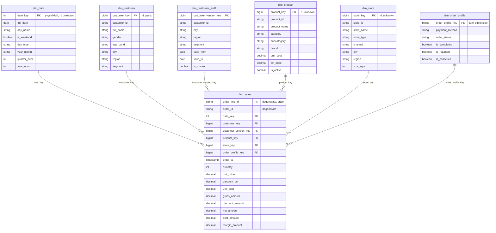

# Design Note — UrbanMart Sales Data Mart

## 1. Kimball's four steps

| Step | Decision |
|---|---|
| **1. Business process** | Retail **sales** — order lines sold through 12 physical stores and 1 online store, including their completion / return / cancellation status. |
| **2. Grain** | **One row in `fact_sales` = one order line (`order_line_id`) of a valid UrbanMart order.** |
| **3. Dimensions** | Date, Customer (SCD1 + SCD2 history), Product, Store, Order profile (junk: payment method × order status). `order_id` and `order_line_id` stay on the fact as degenerate dimensions. |
| **4. Facts** | quantity, unit price, discount rate, unit cost, gross / discount / net / cost / margin amounts. |

The line grain is the **lowest grain available** in the source. It answers every question of the brief (product and category questions
need the line; store, customer and date questions can be rolled up from it) and it is the only grain at which discount and
margin are exact.

## 2. Dimensions and keys

| Dimension | Surrogate key | Business key | SCD | Unknown member |
|---|---|---|---|---|
| `dim_date` | `date_key` INT `yyyyMMdd` | `full_date` | static | `-1` |
| `dim_customer` | `customer_key` IDENTITY | `customer_id` | Type 1 (latest change applied) | `-1` *Guest / Unknown* |
| `dim_customer_scd2` | `customer_version_key` IDENTITY | `customer_id` + `valid_from` | **Type 2** on city, region, segment | `-1` |
| `dim_product` | `product_key` IDENTITY | `product_id` | Type 1 | `-1` *Unknown product* |
| `dim_store` | `store_key` IDENTITY | `store_id` | Type 1 | `-1` *Unknown store* |
| `dim_order_profile` | `order_profile_key` IDENTITY | `payment_method` + `order_status` | junk (static combinations) | `-1` |

- **IDENTITY `GENERATED BY DEFAULT`** (not `ALWAYS`) so the unknown member can be inserted with the explicit key `-1`.
- `dim_date` uses a **smart key** (`20250131`): readable, deterministic, and it lets the fact be clustered and pruned by date.
- Dimensions are loaded with **`MERGE` on the business key**, so surrogate keys are stable across runs.

## 3. Measures

| Measure | Formula | Type | How to aggregate |
|---|---|---|---|
| `quantity` | source | **Additive** | `SUM` over any dimension |
| `gross_amount` | `quantity × unit_price` | **Additive** | `SUM` |
| `discount_amount` | `round(gross × discount_pct, 2)` | **Additive** | `SUM` |
| `net_amount` | `gross − discount` | **Additive** | `SUM` |
| `cost_amount` | `quantity × unit_cost` | **Additive** | `SUM` |
| `margin_amount` | `net − cost` | **Additive** | `SUM` |
| `unit_price`, `unit_cost` | source / dim_product at load time | **Non-additive** | never `SUM`; use `SUM(amount) / SUM(quantity)` |
| `discount_pct` | source | **Non-additive** | use `SUM(discount_amount) / SUM(gross_amount)` |
| margin %, return rate, average order value | ratios | **Non-additive** | compute from the additive sums at query time |
| distinct customers / orders | `COUNT(DISTINCT …)` | **Non-additive** | recount at each level — never add up counts from a lower level |

**Semi-additive:** there is no balance-type measure in this process (no stock level, no account balance), so there is no
semi-additive measure in `fact_sales`. An inventory snapshot fact (units on hand per store per day) would be the typical one —
additive across stores and products, but **not** across time.

`unit_cost` is copied onto the fact at load time. `dim_product` is SCD1, so a later cost change would otherwise rewrite historic margin.

## 4. Guests, unknown products and other edge cases

| Case | Handling |
|---|---|
| Guest order (blank `customer_id`, 312 orders) | The order is kept; `customer_key = customer_version_key = -1` (*Guest / Unknown*, segment *Guest*). Guests count in revenue, but are excluded from customer rankings. |
| Product not in the catalogue (`PX000`) | The sale is kept with `product_key = -1`. Cost is unknown → `cost_amount` and `margin_amount` are `NULL` (not 0, which would show a fake 100 % margin). |
| Placeholder product `P9999` in the catalogue | Rejected in silver; the unknown member replaces it. |
| Order line whose order does not exist | Rejected (`ORPHAN_ORDER`). Without the order there is no date, store or customer. |
| Negative quantity | Rejected (`NON_POSITIVE_QUANTITY`); returns are expressed by `order_status = Returned`, not by negative lines. |
| Returned / Cancelled orders | Kept in the fact. Revenue = *Completed*; return rate = Returned ÷ (Completed + Returned); Cancelled ignored. |
| Lookup miss for any dimension | `LEFT JOIN` + `coalesce(key, -1)`: a missing member never drops a sale. Validation V04–V09 proves no fact key is orphaned. |

## 5. SCD Type 2 and the point-in-time join

`dim_customer_scd2` keeps the history of **city, region and segment**:

- Version 1 = master record, `valid_from = 1900-01-01` (no older history exists, and some orders predate `signup_date`).
- Every row of `customer_changes` opens a new version on its `effective_date`; the previous version closes the day before.
- The fact stores `customer_version_key`, looked up with
  `order_date BETWEEN valid_from AND valid_to` — the version valid **on the order date**.

So `fact_sales → dim_customer` answers *"who is this customer today?"* and `fact_sales → dim_customer_scd2` answers
*"what segment was the customer in when they bought?"*. Example: C0027 was *Retail* in Patras until 2025-04-11 and
*Loyalty Gold* in Heraklion from 2025-04-12; orders before that date are attributed to Retail.

## 6. Physical design (Delta / Unity Catalog)

| Feature | Where | Note |
|---|---|---|
| `PRIMARY KEY` / `FOREIGN KEY` | all gold tables | **Informational only** in Unity Catalog — they document the model and draw the ERD in Catalog Explorer, but are not enforced. Uniqueness and orphans are tested in `06_validation`. |
| `CHECK` | `fact_sales` (quantity > 0, unit_price > 0, discount 0–1, net = gross − discount ≥ 0), `dim_customer_scd2` (valid_to ≥ valid_from) | **Enforced** by Delta: a violating write fails. |
| `NOT NULL` | keys and mandatory columns | Enforced. |
| Liquid clustering `CLUSTER BY (date_key)` | `fact_sales` | Most queries filter / group by period. Replaces partitioning (24k rows would make tiny partitions). |
| Change Data Feed | dimensions and fact | Allows downstream incremental consumers and shows row-level changes between versions. |

## 7. Design trade-offs

1. **Line grain vs order grain.** Line grain is bigger, but order grain cannot answer category / brand questions or compute exact margin.
2. **Reject vs repair.** Negative quantities could have been turned into `abs(quantity)` — but that is a guess about intent. Rejecting keeps the
   fact honest and every rejected row stays traceable in `etl_rejects` with its raw JSON.
3. **Unknown member vs reject for the unknown product.** The sale really happened (the till took the money), so the revenue is kept; only the
   margin is unknown. The opposite choice for the orphan order: without the header nothing about the sale is known.
4. **`MERGE` vs `CREATE OR REPLACE` in gold.** A full rebuild is simpler, but would renumber IDENTITY keys on every run and break any
   consumer that stored them. `MERGE` on business keys keeps keys stable and makes re-runs no-ops.
5. **Junk dimension vs flags on the fact.** Two low-cardinality attributes become one 10-row dimension instead of two text columns on every
   fact row; the model stays a clean star.
6. **SCD1 *and* SCD2 for the customer.** Most dashboards want the current segment (simple join); point-in-time analysis needs history. Keeping both
   costs one extra key on the fact.
7. **Informational PK/FK + tests.** Unity Catalog does not enforce them, so trust comes from the validation gate, not from the DDL.
8. **Full-snapshot `MERGE … WHEN NOT MATCHED BY SOURCE THEN DELETE`.** Correct because each extract is a full snapshot. With true incremental
   (delta) extracts that clause must be removed, otherwise lines missing from the increment would be deleted.

## 8. ERD

The same diagram is available live in **Catalog Explorer → `gold.fact_sales` → Entity relationship diagram**, generated from the PK / FK constraints.

The aggregate fact **`fact_sales_monthly`** (grain: month × store × category) is derived from `fact_sales` for the dashboard and is not part of the star above.
